<p align="center">
  
</p>

<p align="center">
  <a href="https://prathmesh-pandya.vercel.app"></a>
  <a href="mailto:ph.pandya1414@gmail.com"></a>
  
  
</p>

<br/>

## `> whoami`

```python
class PrathmeshPandya:
    study     = "M.Sc. Computer Science @ TH Deggendorf"   # focus: AI & LLM systems, Security
    degree    = "B.E. Computer Science (AI/ML) · grade 1.4 (German scale)"
    based_in  = "Regensburg, Germany"
    focus     = ["LLM applications", "Backend", "Data"]
    building  = ["real-time voice AI", "multimodal RAG", "backend, data & test infrastructure"]
    open_to   = ["LLM applications", "agentic software pipelines", "data engineering"]   # internships
    languages = {"English": "C1", "German": "B1"}
```

I work on the part of AI **after the demo**: streaming, cancellation, latency budgets, failure cases and tests.

<br/>

## `> ls ./projects`

<!-- featured -->
<table>
  <tr>
    <td>
      <p>
        
        
      </p>
      <h2>🎙️ AI Call Assistant</h2>
      <p>An <b>offline, real-time voice assistant that runs entirely on CPU</b>. Live audio streams through a FastAPI WebSocket backend into voice activity detection, streaming speech-to-text, a local LLM via an OpenAI-compatible API and sentence-level text-to-speech. Supports <b>barge-in</b>, <b>request cancellation</b> and ordered LLM/TTS streaming, and discloses that it is an AI while storing no audio.</p>
      <p>
        
        
        
      </p>
      <p>
        
        
        
        
        
        
        
        
      </p>
      <a href="https://github.com/prathmeshpandya/AI-Call-Assistant"></a>
    </td>
  </tr>
</table>

<!-- grid -->
<table>
  <tr>
    <td width="50%" valign="top">
      <h3>📚 Multimodal RAG over Technical Docs</h3>
      <p>Knowledge base over technical manuals that extracts <b>text, tables, diagrams and wiring schematics</b>, indexes embeddings and answers with a <b>vision-language model</b>.</p>
      <p></p>
      <p><code>OCR</code> <code>CLIP</code> <code>ViT</code> <code>FAISS</code> <code>Chroma</code> <code>VLMs</code></p>
      
    </td>
    <td width="50%" valign="top">
      <h3>⚡ GPU Image Processing in CUDA</h3>
      <p>Parallel <b>CUDA C++ kernels</b> for brightness, Gaussian blur and Sobel edge detection with a CMake build, <b>benchmarked against a CPU baseline</b>.</p>
      <p></p>
      <p><code>CUDA C++</code> <code>OpenCV</code> <code>CMake</code></p>
      <a href="https://github.com/prathmeshpandya/Real-Time-Image-Enhancement-with-CUDA---Parallel-Computing"></a>
    </td>
  </tr>
  <tr>
    <td width="50%" valign="top">
      <h3>🏠 Real Estate Price Prediction API</h3>
      <p>Feature engineering and <b>cross-validated regression</b> for Bengaluru property prices, served through a <b>Flask REST API</b>.</p>
      <p></p>
      <p><code>Pandas</code> <code>scikit-learn</code> <code>Flask</code></p>
      <a href="https://github.com/prathmeshpandya/Real-Estate-Price-Prediction"></a>
    </td>
    <td width="50%" valign="top">
      <h3>💳 Razorpay Payment Integration</h3>
      <p>Razorpay (<b>UPI, cards, net banking</b>) integrated into a <b>production Django app</b>, with webhook-based event handling and order verification.</p>
      <p></p>
      <p><code>Django</code> <code>REST</code> <code>Webhooks</code></p>
      <a href="https://github.com/prathmeshpandya/Razorpay-Integration"></a>
    </td>
  </tr>
  <tr>
    <td width="50%" valign="top">
      <h3>📊 E-commerce Insights Dashboard</h3>
      <p>Interactive <b>Power BI</b> dashboard turning e-commerce data into <b>KPIs and business insights</b>.</p>
      <p><code>Power BI</code> <code>data visualisation</code> <code>KPIs</code></p>
      <a href="https://github.com/prathmeshpandya/E-commerce_Insights_dashboard"></a>
    </td>
    <td width="50%" valign="top">
      <h3>📸 Best Photo Identifier</h3>
      <p>Hackathon build with team <b>Square Pants</b>: a Python tool that identifies the best photo from a set of similar shots.</p>
      <p><code>Python</code> <code>computer vision</code> <code>hackathon</code></p>
      <a href="https://github.com/prathmeshpandya/Best-Photo-Identifier"></a>
    </td>
  </tr>
</table>

<br/>

## `> cat research.md`

<table>
  <tr>
    <td>
      <p>
        
        
        
      </p>
      <h3>🔐 “Harvest Now, Decrypt Later”: Threat Modeling, Data Exposure Risk Classification and Organizational Prioritization Frameworks for the Post-Quantum Era</h3>
      <p>Adversaries can record encrypted traffic today and decrypt it once a cryptographically relevant quantum computer exists. The paper treats this as a <b>present-day threat</b> for any data that must stay confidential beyond Q-Day.</p>
      <ul>
        <li>🧭 <b>Threat model</b>: a two-phase HNDL model (collection today, decryption after Q-Day), with an <b>Exposure Window</b> metric <code>EW = max(0, Dm − TQ)</code>.</li>
        <li>🗂️ <b>Risk taxonomy</b>: five high-risk data categories (diplomatic, financial, healthcare and genomic, IP and R&amp;D, critical infrastructure credentials), ranked by confidentiality lifetime.</li>
        <li>🪜 <b>Three-tier migration framework</b>: immediate action (now–2026), strategic planning (2026–2029), compliance and hardening (2029–2033).</li>
        <li>📜 <b>Policy alignment</b>: maps the framework to NIST FIPS 203/204/205, NSA CNSA 2.0, NSM-10 and ENISA guidance.</li>
      </ul>
      <p>
        
        
        
        
      </p>
      <a href="assets/HNDL-Research-Paper.pdf"></a>
    </td>
  </tr>
</table>

<br/>

## `> stack --list`

<p align="center">
  
  <br/>
  
</p>

<p align="center">
  
  
  
  
  
  
  
  
  
  
  
  
  
</p>

<br/>

## `> git log --stats`

<p align="center">
  
</p>

<p align="center">
  
  
  
</p>

<br/>

<p align="center">
  <sub><code>~/regensburg $ exit</code> &nbsp;·&nbsp; thanks for stopping by &nbsp;·&nbsp; <a href="https://prathmesh-pandya.vercel.app">Portfolio</a></sub>
</p>
